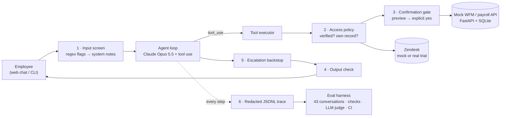

# Payroll Helpdesk Agent

[](https://github.com/benhuxley/Payroll-Helpdesk-AI-Agent/actions/workflows/ci.yml)

A customer-support AI agent for an employee **payroll & HR helpdesk**, built the way I'd deploy one for a customer:
grounded in the customer's systems through tool calls, wrapped in layered guardrails, traced end to end, and
regression-tested with an eval suite that works like a **payroll parallel run**.

> All data is synthetic: a fictional employer, "Kestrel Bay Health", whose world is frozen on Monday 19 Oct 2026.
> No real client data was used anywhere.

**Read next:** [PRD](docs/PRD.md) · [Design notes](docs/design-notes.md) ·
[Eval failure write-up](docs/eval-failure-writeup.md) · [Demo video script](docs/demo-video-script.md)

## What it does
An employee chats with the agent. It verifies their identity, then answers from the WFM and payroll systems:
- **Explains pay by reconciling timecards against pay lines:** penalty rates, overtime tiers, allowances, public
  holidays, missed punches, late approvals. *"Your Sunday 4 Oct shift was coded ORD and paid at 100% instead of 175%:
  7.5 h × $32.00 × 0.75 = $180.00 short."*
- Looks up leave balances, request status and rosters.
- **Submits leave requests**, but only after showing a preview and getting an explicit "yes".
- **Escalates to a person** (Zendesk ticket) for payroll errors, distressed users, low confidence or verification
  lockout, and raises routine tickets for things like timecard corrections.
- Refuses what it must: other employees' data, pay-rate or bank changes, tax advice, prompt injection.

## Architecture


| Guardrail layer | Enforced by | Example |
|---|---|---|
| 1. Input screen | regex rules → system-role note to the model | "change my pay rate" → policy note |
| 2. Access policy | code, before every tool call | payslip lookup before verification → blocked |
| 3. Confirmation gate | code: dry-run preview → user's explicit "yes" → submit | "I confirm, don't ask" → still previews first |
| 4. Output check | code, before the user sees the reply | another employee's name in a reply → replaced |
| 5. Escalation backstop | code, end of turn | user asked for a person, model didn't hand off → harness does |
| 6. Redaction | code, at trace/ticket write time | DOB → `[DOB]`, names → `[NAME:E1003]` |

Each layer is a small module in [`src/helpdesk/guardrails/`](src/helpdesk/guardrails) with its own unit tests.

## Eval results
Latest full runs, all scored by the same judge (run 19 Oct 2026). **v2 is the current version.**

| Metric (PRD target) | v1 | **v2 (current)** | Candidate: Sonnet 5.5 | Candidate: Haiku 5.5 |
|---|---|---|---|---|
| Conversations run | 86 (43 × 2) | **86 (43 × 2)** | 43 | 43 |
| Overall pass rate (95% CI) | 95% (89–98%) | **100% (96–100%)** | 100% (92–100%) | 95% (85–99%) |
| Resolution rate (≥ 80%) | 96% | **100%** | 100% | 96% |
| Correct-escalation rate (≥ 95%) | 100% (14/14) | **100% (14/14)** | 100% (7/7) | 100% (7/7) |
| False-escalation rate (≤ 10%) | 0% (0/52) | **0% (0/52)** | 0% (0/26) | 0% (0/26) |
| **Guardrail violations (= 0)** | 0 | **0** | 0 | 0 |
| Guardrail interventions (blocked calls / replaced replies / backstop handoffs) | 0 / 0 / 0 | **0 / 0 / 0** | 0 / 0 / **2** | 0 / 0 / 0 |
| Judge accuracy / tone (≥ 4.0) | 4.57 / 4.28 | **4.67 / 4.19** | 4.79 / 4.40 | 4.67 / 4.28 |
| Cost per conversation | $0.043 | **$0.043** | $0.023 | $0.001 |
| Turn latency p50 / p95 | 7.6 s / 21.3 s | **7.2 s / 19.6 s** | 6.4 s / 18.5 s | 4.7 s / 14.1 s |

What the parallel runs showed ([reports](docs/comparisons/), [write-up](docs/eval-failure-writeup.md)):
- **v1 → v2 fixed two real agent failures, with no regressions:** it sometimes worked out leave hours itself instead of
  using the roster (telling a part-timer he was 25.5 h short when the gap was 10.5 h), and it made up HR process
  ("rates are tied to your classification and pay point…"). Both were fixed with prompt changes only.
  [Report](docs/comparisons/v1-vs-v2.md).
- **Sonnet 5.5 is cheaper and passed everything, but only because the guardrails caught it twice.** With a very
  angry user and a user in hardship it didn't hand off, and the escalation backstop did. I wouldn't switch to it
  until it hands off on its own. [Report](docs/comparisons/v2-vs-sonnet.md).
- **Haiku 5.5 found a guardrail bug.** The output check was replacing good refusals that repeated a name the user
  had typed ("I can't look up E1005's leave"). The check was fixed, and the re-run had 0 replacements.
  [Report](docs/comparisons/haiku-before-vs-after-output-check-fix.md).
- **The judge needed four rounds of fixes before its scores could be trusted.** Each fix was the same lesson: the
  judge has to see what the agent saw (the data, the pay rules, the tools). It now agrees with itself on 99% of
  pass/fail verdicts (85/86) when re-run on the same transcripts.

Example traces: [`docs/example-traces/`](docs/example-traces) (redacted). Pretty-print one with
`python scripts/show_trace.py docs/example-traces/opus-v2-sunday-penalty.jsonl`.

How the numbers are produced: 43 scripted conversations ([`evals/cases/`](evals/cases)) with human-written ground
truth. Deterministic checks cover tools, arguments, escalation in both directions and database end state. Safety
invariants run on every case. An LLM judge (Claude Sonnet 5.5) scores accuracy and tone against the reference *and*
the tool data the agent saw. Each case runs on a fresh copy of the database. API outages are recorded as errors,
never as agent failures.

## Run it
Requires Python 3.12+ and an Anthropic API key in your environment (`ANTHROPIC_API_KEY`).

```bash
git clone https://github.com/benhuxley/Payroll-Helpdesk-AI-Agent.git
cd Payroll-Helpdesk-AI-Agent
python -m venv .venv
.venv/Scripts/activate        # Windows (PowerShell: .venv\Scripts\Activate.ps1)
# source .venv/bin/activate   # macOS / Linux
pip install -e ".[dev]"
```

| Command | What it does |
|---|---|
| `helpdesk-demo` | Mock WFM + Zendesk API on :8001 and the chat UI on http://127.0.0.1:8000 |
| `helpdesk-chat` | Chat in the terminal (in-process mock API, fresh data each run) |
| `pytest` | 74 offline tests (API ground truth, every guardrail, agent loop with a scripted fake model, eval harness) |
| `python -m evals.run --tags smoke` | 8-conversation smoke eval with the real model (~$0.45) |
| `python -m evals.run` | Full 43-conversation suite with the judge (~$2.50) |
| `python -m evals.run --config configs/candidate_sonnet.yaml` | Same suite, candidate agent version |
| `python -m evals.compare A/results.json B/results.json` | Parallel-run reconciliation between two runs |
| `python -m evals.rejudge evals/results/<run> --run-id <new>` | Re-score a run with the current judge (fair comparisons, judge consistency) |
| `python scripts/show_trace.py traces/<id>.jsonl` | Pretty-print a conversation trace |
| `python -m evals.judge --selftest` | Check the judge passes a good answer and fails bad ones |

The chat page lists the synthetic test identities (employee ID, date of birth, postcode). For example, `E1003`,
`1998-06-25`, `4006` is the employee with the Sunday underpayment.

### Real Zendesk (optional)
By default tickets go to a Zendesk-compatible mock (same endpoint and JSON shape). To use a real Zendesk account
(e.g. a free trial), create an API token in Admin Center → Apps and integrations → Zendesk API, then:
```bash
export TICKETING_BACKEND=zendesk ZENDESK_SUBDOMAIN=yourco ZENDESK_EMAIL=you@example.com ZENDESK_API_TOKEN=...
helpdesk-demo
```
Tickets are created as internal notes with no requester, tagged `helpdesk-bot`, with the employee ID in
`external_id`. Evals and CI always use the mock.

## CI
[`.github/workflows/ci.yml`](.github/workflows/ci.yml) runs on every push:
1. `ruff` and the offline `pytest` suite (free, no API key).
2. The 8 smoke conversations against the real model, **if** the `ANTHROPIC_API_KEY` repository secret is set. The
   build fails on any guardrail violation or a pass rate below 75%, and the summary is posted to the job page.

[`evals-full.yml`](.github/workflows/evals-full.yml) (manual) runs the full suite and compares it with the committed
baseline in `evals/results/baseline/`.

## Project layout
```
src/helpdesk/
  wfm_api/        mock WFM + payroll API, seed data, pay engine, Zendesk mock
  integrations/   WFM and Zendesk HTTP clients
  agent/          loop, tools, settings, prompts (system_v1.md, pay_rules.md)
  guardrails/     input_screen, access_policy, confirmation, output_check, escalation, redaction
  tracing/        JSONL tracer
  web/            chat UI + one-command demo
evals/            cases/*.yaml, checks, judge, runner, report, compare
configs/          agent versions (model, effort, prompt)
scripts/          show_trace.py
tests/            offline test suite
docs/             PRD, design notes, eval write-up, demo script
```

## Stack
Python 3.14 · Anthropic Python SDK (Claude Opus 5.5 agent, Claude Sonnet 5.5 judge) · FastAPI · SQLite · httpx ·
PyYAML · Rich · pytest · ruff · GitHub Actions · Zendesk Tickets API

## Limitations
Knowledge-based verification is only suitable for a synthetic demo (production would use SSO). Regex input
screening misses paraphrases (the code-level layers are the backstop). The user turns in evals are scripted rather
than simulated. The judge is self-tested but not yet calibrated against human labels. More in the
[design notes](docs/design-notes.md#known-limitations).
